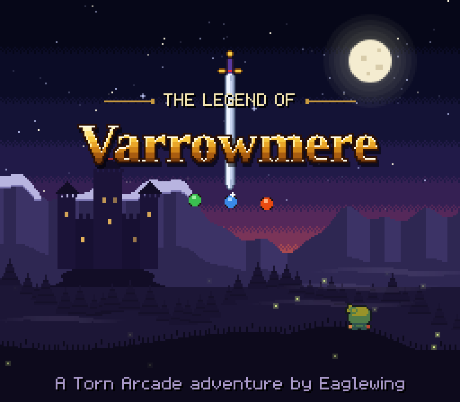
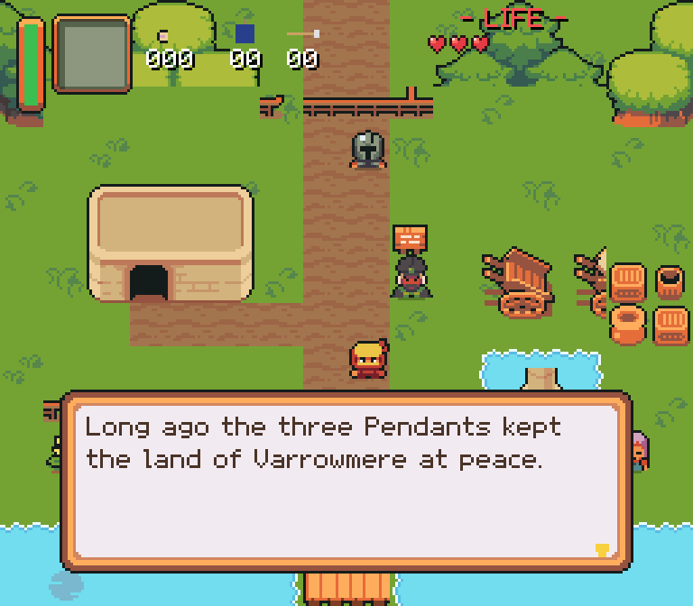
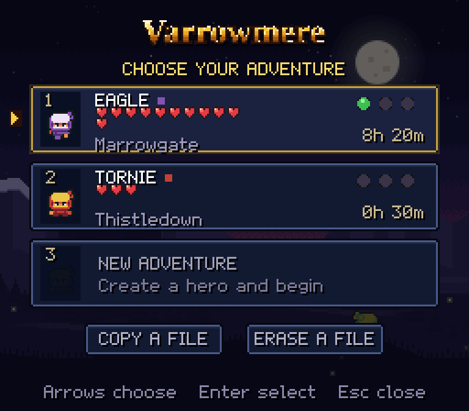
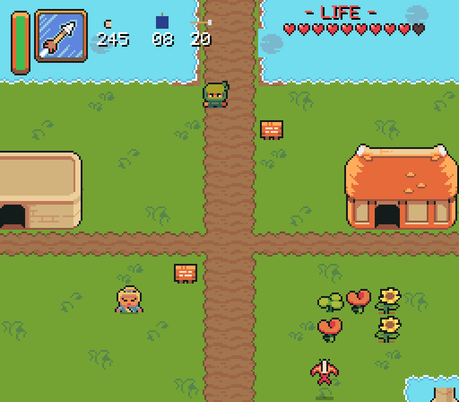
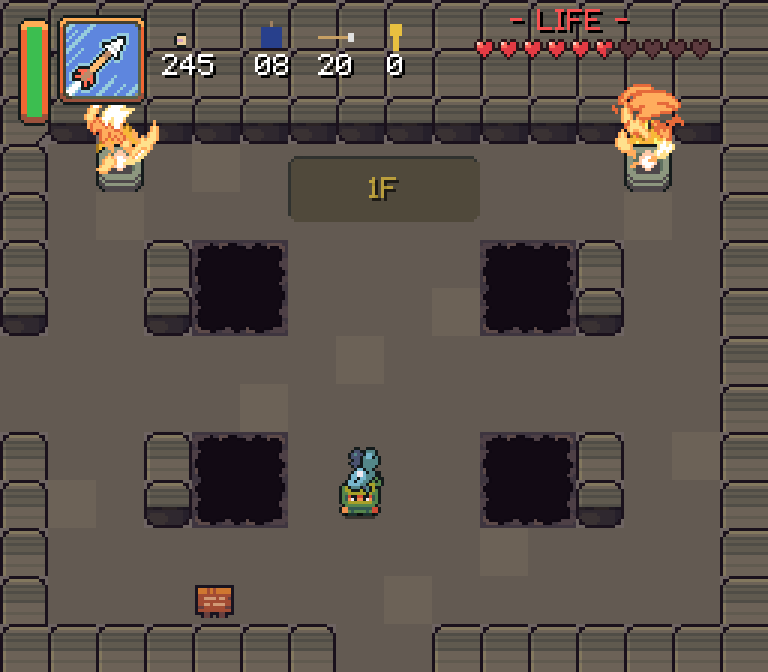
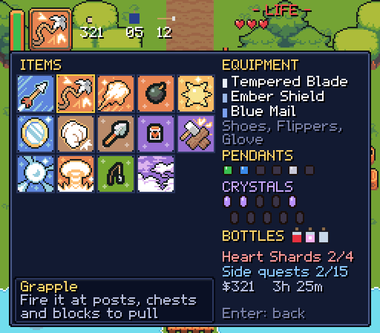
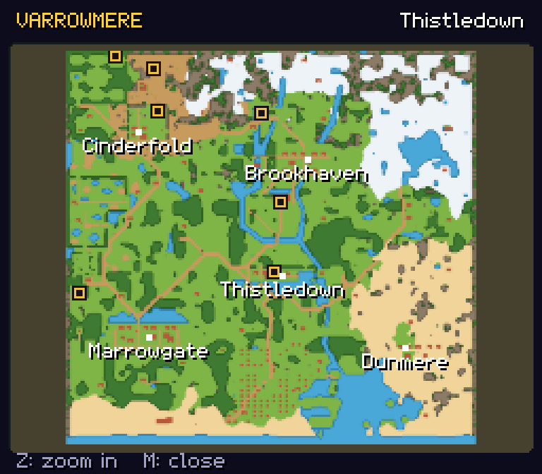

# ⚔️ Legend of Varrowmere

**A top-down action-adventure for [Torn](https://www.torn.com), by Eaglewing [571041].**

> ⚠️ **For use on Torn only.** Legend of Varrowmere is licensed solely for use on [torn.com](https://www.torn.com) through a userscript manager. Copying, modifying, redistributing or reusing it is not allowed without written permission from the author. See [Licence](#-licence).

Legend of Varrowmere is a full adventure in the style of the 16-bit classics, made for Torn. It opens in its own window over the Torn page, from the **Legends** folder on the [Torn Arcade](https://github.com/Eaglewing91/Torn-Arcade.user.js) phone or from the Tampermonkey menu. It makes no requests of any kind and needs no API key.

> ⭐ **A Premium Game, free for now.** Legend of Varrowmere will be listed as a Premium Game in Torn Arcade. It is completely free until Torn Staff approve a subscription service. Only Legends games will be premium; every other Torn Arcade game will remain free.

---

## ⬇️ Install

1. Install the [Tampermonkey](https://www.tampermonkey.net/) browser extension.
2. Install the game: **[Legend of Varrowmere](https://github.com/Eaglewing91/Legend-of-Varrowmere/raw/main/build/Legend-of-Varrowmere.user.js)** (about 1.5 MB).
3. Optional, but recommended: the soundtrack, in two parts: **[Soundtrack Part 1](https://github.com/Eaglewing91/Legend-of-Varrowmere/raw/main/build/Legend-of-Varrowmere-Soundtrack.user.js)** (title, towns, fields, bosses) and **[Soundtrack Part 2](https://github.com/Eaglewing91/Legend-of-Varrowmere/raw/main/build/Legend-of-Varrowmere-Soundtrack-2.user.js)** (Shadow world, dungeons, caves, ending), about 1.8 MB each. Without them the game plays simple built-in tunes.
4. Reload Torn. Open the **Legends** folder on the Torn Arcade phone and tap **Varrowmere** (it plays inside the phone), or choose **Play Legend of Varrowmere** in the Tampermonkey menu.

The game and its music are separate scripts so each stays under 2 MB. Both update themselves through Tampermonkey. Your saves are kept in Tampermonkey's storage on your device, and updating keeps them.

It plays with a keyboard and mouse, or with the on-screen touch pad (🎮).

## 🎮 Controls

| Key | Action |
|---|---|
| Arrows or WASD | Move |
| Z (or J), or mouse click | Sword (hold, then let go, for a Spin Attack) |
| X (or K) | Use the selected item |
| C, Space (or L) | Talk, read, lift, open |
| Shift (or V) | Dash (once you have the Running Shoes) |
| Enter | Items and status screen |
| M | Map |
| N | Music on or off |
| Esc | Close the game (it saves) |

## 📖 The story

Long ago, three Pendants kept the land of Varrowmere at peace. Now Chancellor Vex rules from Ashford Castle, and his Gilded Hand patrol every road. You wake in Thistledown after a dream of a voice calling from the Meadow Ruins...

Win the Pendants and draw the Dawnblade. Break Vex's barrier, then follow him through the Twin Mirror into Shadow Varrowmere, gather the Crystals and end it in the Shadow Keep.

## 🗺️ What's in it

- **Two worlds.** Varrowmere and its Shadow twin, each about 50% bigger than the 1991 classic's: towns, farmland, forests, snowy peaks, a frozen lake, swamps, a desert, a long coast. The Twin Mirror crosses between them at the same spot.
- **19 dungeons.** Every one hand-designed over several floors, with keys, a map, a compass, a Big Key, puzzles (crystal switches, dark rooms, pressure plates, water levels, push blocks), a mini-boss and a boss of its own.
- **Unique bosses and foes.** Dozens of monsters with their own habits, and a different master at the end of every dungeon.
- **Gear and tools.** The Bow, Grapple, Power Glove, Twin Mirror, Ember and Frost Rods, Brick Wand, Bug Net, bottles, armour and shields, a few with Torn names (the Molotov Cocktail, Flash Grenade, Pepper Spray and Ninja Stars).
- **15 side quests.** Walk a lost old man home through the snow, show a sick child a fairy, wish at the Wishing Pond for bigger bags, dig up a merchant's ring, play hide and seek, help a ghost, carry a hopping chest across the Shadow, make the Shadow Jester laugh, and more.
- **Towns, shops and secrets.** Furnished houses, shops with their own stock, cellars, secret caves, fairy fountains and three Great Fairies.
- **Three heroes.** Three save files, each with its own named hero and tunic colour. Files can be copied or erased.
- **Torn Arcade leaderboards.** Total playtime, Completion and Monsters defeated appear in the Arcade's Leaderboards (the global boards need the Arcade's optional Online play).

| | |
|---|---|
|  |  |
|  |  |
|  |  |

## 🔒 Safety and Torn's rules

- **No requests.** The game never talks to any website: no API, no servers, no websockets. Everything it shows is built into the script.
- **Never touches Torn's page.** It doesn't read, click or change anything in Torn. It only opens its own window over the page.
- **No automation.** It's a game in a window, nothing more.
- **Light on Torn.** On pages where you don't play, it only adds its menu entry. The game is only unpacked and run when you press Play.
- **Torn Arcade link.** The game and the Arcade talk only through browser events on the page you're viewing (`varrowmere:ping`, `here`, `open`, `closed`, `scores`). No data leaves your browser unless you turned on the Arcade's own optional Online play, which sends your three leaderboard numbers to the Arcade's leaderboards.

## 📜 Terms of service

| | Legend of Varrowmere | Soundtrack (both parts) |
|---|---|---|
| **Data Storage** | Only locally (your save files and leaderboard numbers, in Tampermonkey storage) | No |
| **Data Sharing** | Nobody (the game sends nothing; Torn Arcade's optional Online play can submit your leaderboard numbers under the Arcade's terms) | Nobody |
| **Purpose of Use** | Public amusement | Public amusement |
| **Key Storage & Sharing** | Not stored / Not shared (no API key is used) | Not stored / Not shared |
| **Key Access Level** | None (no API key needed) | None |

## 🎨 Credits

- Game, world, story, code and original art: **Eaglewing [571041]**.
- Characters, monsters, bosses, items, icons, effects, tiles, music and sound: **"Ninja Adventure"** by Pixel-boy and AAA, [CC0](https://pixel-boy.itch.io/ninja-adventure-asset-pack).
- Townspeople: **"Mana Seed" Character Base** and add-ons by [Seliel the Shaper](https://seliel-the-shaper.itch.io/), used under licence with the artist's permission. This art is not CC0 and may not be taken out of the script.
- Tiles and sprites: **"Zelda-like tilesets and sprites"** by ArMM1998, [CC0](https://opengameart.org/content/zelda-like-tilesets-and-sprites).

## 📝 Changelog

See [CHANGELOG.md](CHANGELOG.md).

## ⚖️ Licence

All rights reserved, for use on Torn only. See [LICENCE](LICENCE). The CC0 art and sound packs above stay CC0 and are not claimed. Legend of Varrowmere is an unofficial fan project, not affiliated with Torn.

Bugs or ideas? Message **Eaglewing [571041]** on Torn.
